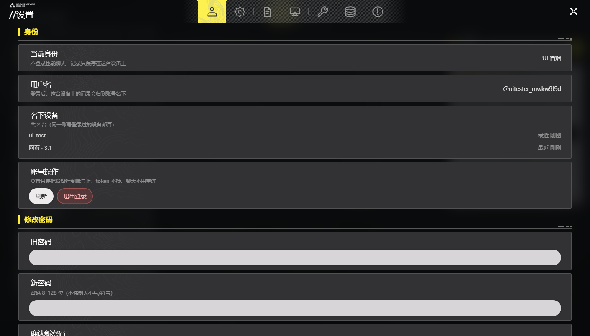

# 登录与账号

> 后端权威文档：`web/back/docs/03-登录与身份.md`；接口实现：`web/back/app/api/auth.py`。
> 前端实现：`src/utils/apiClient.ts`（设备凭证）、`src/utils/auth.ts`（账号接口）、
> `src/stores/account.ts`（状态）、`src/components/layout/SettingsDialog.vue`（账号页）。

---

## 1. 一句话架构

```
设备凭证（匿名 token）──登录──► 同一张 token 挂到账号上
        │                          │
        │  访客：数据只归这台设备     │  已登录：数据归账号，名下所有设备可见
        └──────────────────────────┘
```

- **登录不换 token**。客户端手里那张匿名设备凭证继续用；登录只是服务端把
  `devices.owner_user_id` 填上、把 `conversations.user_id` 从 NULL 改成账号 id。
- 所以前端**没有**"登录后重新初始化"这一步：不重拉会话、不重建连接、不清缓存。
- 登出同理：只把设备从账号上摘下来，数据一条不动；重新登录立刻回来。

---

## 2. 接口与调用时机

| 端点 | 谁调 | 时机 |
|---|---|---|
| `POST /v1/auth/device` | `apiClient.ensureDeviceToken()` | 第一个需要鉴权的请求之前（自动） |
| `GET /v1/auth/me` | `accountStore.refresh()` | 启动时后台一次；切到「账号」页且状态未知时一次；点「刷新」 |
| `POST /v1/auth/register` | 账号页「注册并登录」 | 用户提交注册 |
| `POST /v1/auth/login` | 账号页「登录」 | 用户提交登录 |
| `POST /v1/auth/logout` | 账号页「退出登录」 | 用户点击 |
| `POST /v1/auth/password` | 账号页「修改密码」 | 用户提交（验旧密码） |

返回：

```jsonc
// register / login
{ "user": { "id": "...", "username": "三叶草", "display_name": "三叶草", "created_at": "..." },
  "adopted_conversations": 3 }   // 这次收编了几条"登录前在本设备聊的"记录

// me
{ "kind": "guest" }                                  // 访客
{ "kind": "user", "user": {...}, "devices": [ {...} ] }  // 已登录

// logout / password → 204，无 body
```

`adopted_conversations > 0` 时账号页会给一句
「登录成功：昵称（已把 N 条记录并入账号）」。

---

## 3. 界面（设置 → 账号）

- **访客**：说明文字 + 「登录 / 注册」两个页签 + 用户名/密码（注册多一个确认密码、可选昵称）。
- **已登录**：当前账号（昵称、@用户名、注册时间）、名下设备列表（平台 / 版本 / 最近活跃）、
  「刷新 / 退出登录」、修改密码（旧密码 + 新密码 + 确认）。
- 所有错误都显示在面板底部（本地校验用黄色、服务端错误也用黄色、成功用绿色）。
- 入口只有设置侧栏的「账号」页：**没有**改动主界面布局。

已登录时的样子（本地实测截图）：



---

## 4. 规则（前后端必须一致）

| 项 | 规则 | 前端代码 |
|---|---|---|
| 用户名 | 2–20 字符；中文/字母/数字/下划线；**首位必须是中文或字母** | `utils/auth.ts` `USERNAME_PATTERN` |
| 用户名大小写 | 不区分（数据库 `_ai_ci`），存用户打的原样 | 不做 `lower()` |
| 密码 | 8–128 字符；**不强制**大小写/符号 | `PASSWORD_MIN/MAX` |
| 登录失败 | 不区分"没这个人"和"密码错"，同一句话 | 后端保证，前端不猜 |

表单提交前先做一次本地校验（省一次网络往返），最终判定仍在服务端；
两边提示文案取自同一句规则说明。

---

## 5. 错误码 → 文案

| HTTP | code | 显示 |
|---|---|---|
| 400 | `bad_request` / `weak_password` | 后端 message（用户名/密码规则） |
| 401 | `bad_credentials` | 用户名或密码不对 |
| 403 | `account_disabled` | 这个账号已被停用 |
| 409 | `username_taken` | 这个用户名已经有人用了，换一个吧 |
| 409 | `device_taken` | 这台设备已经登录了另一个账号，请先登出 |
| 429 | `too_many_attempts` | 尝试次数太多了，约 N 秒后再试 |
| 429 | `device_gate_busy`（哈希闸门） | 服务繁忙（限速），约 N 秒后再试 |

`device_taken` 只在"本机状态与服务端不一致"时出现（例如换了浏览器但 token 还是旧的）：
按提示先登出，再登录目标账号。

---

## 6. 数据归属与本地存档

- 服务端：登录后 `conversations.user_id` 写账号；换设备登录同一账号，**服务端**那批会话可见。
- 本地：界面的卡库/子对话是玩家自己的本地存档（导出/导入用），登录与登出**都不动它**。
  这是刻意的取舍：清本地等于删玩家存档，风险远大于"别人拿你手机看到历史"；
  真要隐私，用「数据管理 → 清空」。
- 登出后服务端数据不可见（设备被摘下），重新登录即恢复 —— 与后端测试
  `test_logout_hides_account_data_then_relogin_restores` 同一语义。

---

## 7. 安全注意

- 设备 token 明文存在 `localStorage['baker_device_token']`（与后端设计一致：
  库里只存 sha256，明文只在客户端）。共用电脑时请主动「退出登录」。
- 改密码会**摘掉其它设备**（不是删数据）：别的手机立刻看不到账号数据，这台不用重登。
- 当前没有"找回密码"：丢了只能管理员重置（后端 `docs/03 §7`）。
- 前端不做"登录失败 N 次锁定"：后端已有每设备 10 次/分 + 每账号 20 次/15 分两道限流。

---

## 8. 自测

`scripts/contract-smoke.mjs` 第 9–10 节覆盖：注册 → me → 登出（me=guest）→ 重新登录 → 改密 → 旧密码错 401。
实测 27/27 通过。界面层另做过一次无头浏览器全流程（填表 → 点登录 → 出现「当前账号」与「退出登录」，
console 0 错误），方法见 [`04-验收与自测.md`](04-验收与自测.md) §4。

---

## 9. 取件码：换设备搬数据的两条路

> 后端契约：`POST /v1/uploads`（免登录上传）、`GET /v1/uploads/{code}`（免登录验码）、
> `POST /v1/uploads/claim`（要登录）、`POST /v1/auth/register` 的新字段 `claim_code`。
> 前端：`src/utils/cloudData.ts`（上传/验码/领取）、`src/utils/auth.ts`（注册带码）、
> `DataManagerDialog.vue`（数据管理页）、`SettingsDialog.vue`（账号页）。

### 9.1 旧设备：拿码

设置 → 数据管理 → 云同步 → 「一键上传数据」：
用与本地「导出 JSON」**完全相同**的包（`exportToJson`）做 `FormData`（字段名 `file`），
上传成功后显示 8 位取件码 + 有效期（24 小时）+「24 小时内可在任意设备领取，可重复领取」。

### 9.2 新设备路线 A（推荐）：注册时填码

设置 → 账号 → 注册，多一个可选输入框「取件码（可选）」（8 位、自动大写、去空格）。

- 提交时把 `claim_code` 和用户名/密码一起发；后端**建账号的同时**把包领到账号名下。
- 码无效/过期 → `400 bad_claim_code`，**整次注册回滚**（账号没创建）。
  界面用红底提示"这次没有注册成功，账号没有创建"，并且**不清空**已填的用户名/密码。
- 成功后顺手做两件事：`GET /v1/imports` 取最近一次导入当摘要（显示领到了几段会话）；
  清掉本地 `baker_v1_bindings`，让下次聊天接上刚导入的服务端会话。

### 9.3 新设备路线 B：已登录后领取

- 数据管理页：未登录时不让输码，直接给一句"去『设置 → 账号』注册，注册时把码填进
  『取件码（可选）』"和跳转按钮；已登录时输入码 → 先 `GET` 验码 → 再 `POST claim`。
- 账号页（已登录）：同一功能的「领取历史数据」小入口，接口与效果完全一样。

### 9.4 错误文案（前端翻好的人话）

| HTTP | 场景 | 显示 |
|---|---|---|
| 404 | 码不存在 | 取件码不存在：请核对有没有输错（只有大写字母和数字，别把 0 打成 O） |
| 410 | 码过期 | 这个取件码已经过期了（有效期 24 小时）：回原设备重新上传拿新码 |
| 413 | 包太大 | 单份上限 64MB：先删一些图片，或用「导出数据」的 ZIP 再传 |
| 429 | 上传太频繁 | 同一网络每小时最多 5 次，约 N 分钟后再试 |
| 507 | 服务器存储满 | 服务器存储满了，暂时不能上传，请过一会儿再试 |
| 401 | 领取没登录 | 这个操作要先登录：去「设置 → 账号」登录，或在注册时填码 |
| 400 | 包读不出 | 服务器读不出这个包：用「导出 JSON / 导出数据」生成的文件再试 |
| 400 | `bad_claim_code` | 取件码无效或已过期：这次没注册成功（账号未创建），换个码或去掉码重试 |

同一份包被同一台设备重复领取时，后端回 `duplicate: true`；界面文案会说明
"之前领过、后端按内容去重（没有重复导入）"，避免用户以为没领到东西。
